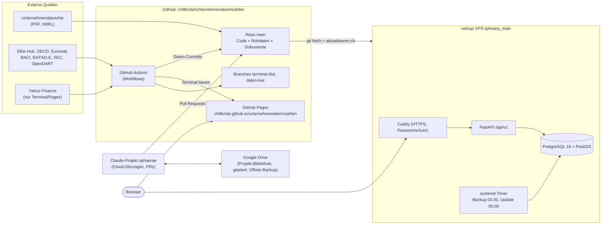
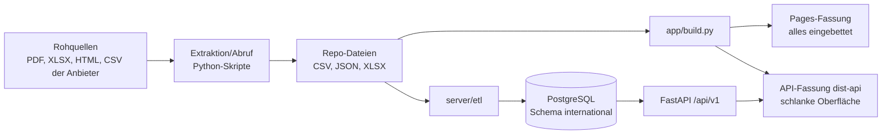
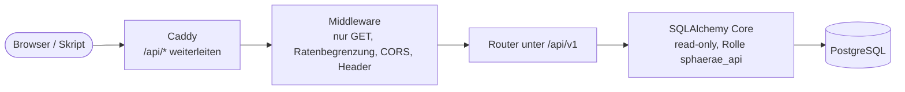
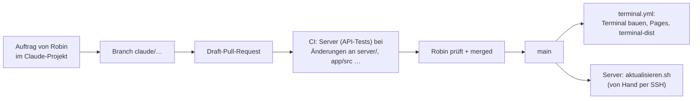

# Projektübersicht: Wo liegt was, in welcher Form, wer hat Zugriff, wie ändert man etwas

Stand 11.11.2026, abgeleitet aus dem Repo-Stand (`main`, Merge von PR #188), den Workflow-Dateien, `server/` und den Dokumenten unter `docs/`.
Keine Zugangsdaten in diesem Dokument. Mit **(unklar)** gekennzeichnete Punkte konnte ich aus dem Repo nicht belegen.
Eine anschauliche HTML-Fassung mit denselben Diagrammen liegt als Artifact im Projekt.

## 1. Das Gesamtbild

Zwei Auslieferungswege laufen heute parallel:

| Weg | Adresse | Inhalt | Stand |
|---|---|---|---|
| GitHub Pages | `chillkrote.github.io/unternehmenskennzahlen` | Terminal und Weltkugel als große HTML-Dateien mit eingebetteten Daten (ca. 69 MB) | läuft, bleibt Referenz und Rückfall |
| netcup-Server | `https://neu.sphaerae.de` | schlanke Oberfläche, lädt Daten über die API aus PostgreSQL | läuft als Test, **nicht live**; `sphaerae.de` zeigt noch nicht darauf (Robin, 11.11.) |

## 2. Dateistruktur: Wo liegt was?

```mermaid
flowchart TB
  root["Unternehmenskennzahlen/"]
  root --> Code["Code und Werkzeuge"]
  root --> Daten["Daten und Erhebungen"]
  root --> Doku["Dokumentation"]
  root --> CI[".github/"]
  Code --> app["app/ Terminal + Weltkugel<br/>build.py, src/*.js, data/*.json"]
  Code --> server["server/ API, Alembic, ETL, Docker, deploy/"]
  Code --> desktop["desktop/ macOS-App (Electron)"]
  Code --> intl["international/ Kernmodell-SQL, Länder-Adapter"]
  Daten --> stamm["stammdaten/ IDs U000123, ISIN, Beziehungen"]
  Daten --> banken["banken/ 129 Banken GJ2025"]
  Daten --> boerse["boersennotierte-unternehmen/ ca. 540 AGs"]
  Daten --> europa["europa/, abschluesse-nichtbanken/,<br/>unternehmen-tabelle/"]
  Daten --> vwl["volkswirtschaft/ Reihen, Prognosen, regional/"]
  Daten --> wahlen["wahlen/, kommunalwahlen/"]
  Daten --> gov["governance/ Gremien, Vergütung, Personen"]
  Daten --> zr["zeitreihen/, termine/, segmente/, esg/"]
  Doku --> docs["docs/ Architektur, API, Betrieb, Datenquellen"]
  Doku --> rev["review/, pruefung/, verbesserungen/"]
  CI --> wf["workflows/ 12 Workflows"]
  CI --> sc["scripts/ daten_pushen.sh, pdf_platzhalter.py"]
```

| Ordner | Inhalt | Hauptformate |
|---|---|---|
| `app/` | Quelltext der Oberfläche (`src/*.js`, `*.css`), Abrufskripte (`*_abruf.py`, `marktdaten.py`, `vwl.py`, `landtagswahlen.py` …), Build (`build.py`), Datenpakete `app/data/*.json` (zusammen ca. 52 MB: `unternehmen`, `banken`, `welt`, `wahlen`, `handel`, `markt` …), Geodaten `geo/` | Python, JS, JSON, GeoJSON |
| `server/` | `plattform/` (FastAPI), `alembic/versions/0001–0009`, `etl/` (Import in die DB), `katalog/` (Datenquellenkatalog), `deploy/` (Caddyfile, Backup, Einrichtungsskripte), `docker-compose.yml`, Tests | Python, SQL, Shell, YAML |
| `international/` | SQL-Migrationen des Kernmodells, Länder-Piloten (`*_pilot.csv`, `pruefung_*.csv`), Adapter (SEC, OpenDART, ESEF) | CSV, Python, SQL |
| `stammdaten/` | zentrale Unternehmens-IDs (`unternehmen_ids.csv`), ISIN-Zuordnung, Aliase, Beziehungen, Prüfskript `pruefe_ids.py` | CSV, Python |
| `banken/bilanzvergleich-gj2025/` | Erhebung 129 Banken: `dokumente/` (Originalberichte), `rohdaten/`, `auswertung/` | PDF, JSON, CSV, XLSX |
| `boersennotierte-unternehmen/` | je Branche eine Excel mit Bilanz, GuV, Cashflow, Aktionären; Berichte | XLSX, PDF |
| `europa/`, `abschluesse-nichtbanken/`, `unternehmen-tabelle/` | Europa-Erhebung, Abschlüsse Nichtbanken, Gesamttabelle der Unternehmen | JSON, CSV, XLSX |
| `volkswirtschaft/` | Länderreihen, Prognosen aller Prognosegeber, ifo, `regional/` (Kreisdaten NUTS-3) | CSV |
| `wahlen/`, `kommunalwahlen/` | Wahlergebnisse, Grenzen | CSV, GeoJSON, JSON |
| `governance/` | Gremien, Vergütung, Personenprofile (enthält Personenbezug, siehe Abschnitt 5) | CSV |
| `zeitreihen/`, `termine/`, `segmente/`, `esg/` | Zeitreihen im Langformat, Berichtstermine, Segmente, ESG | CSV |
| `docs/` | `architektur.md`, `api.md`, `datenmodell.md`, `datenquellen.md`, `betrieb.md`, `server-einrichtung.md`, `migration-netcup.md`, Audit- und Abdeckungsberichte | Markdown |
| `historie_berichte/` (nur im Projektordner, Bibliothek) | Historische Berichte ab 2017 je Unternehmen-ID | PDF |

Hinweis: Das Repo trägt auch Dokumentmengen von mehreren GB (rund 1.000 PDFs). Workflows und der Server-Checkout holen deshalb nur Code und kleine Daten (`filter: blob:none`, ohne `*.pdf`/`*.gz`).

## 3. In welcher Form liegen die Daten vor?

| Stufe | Form | Beispiel | Zweck |
|---|---|---|---|
| Original | PDF, HTML-Schnappschuss | Jahresabschlüsse unter `banken/…/dokumente/` | Nachvollziehbarkeit, je Dokument SHA-256 in `index.csv` |
| Rohdaten | JSON/CSV/XLSX | `rohdaten/`, `europa/daten/`, `volkswirtschaft/*.csv` | extrahierte Werte mit Quelle und Seite |
| Gebaute Datenpakete | JSON (`app/data/*.json`) | `unternehmen.json`, `wahlen.json` | Eingabe für Build und ETL |
| Datenbank | PostgreSQL-Tabellen (Schema `international`) | `company`, `fact`, `series`/`observation`, `region`, Handelstabellen, `data_source`, `ingestion_run` | Abfragen über die API |
| Auslieferung | HTML + JSON | `bankterminal.html`, `weltkugel.html` (Pages) bzw. `dist-api/` (Server) | Anzeige im Browser |

Datenbankmodell in Kürze (`docs/datenmodell.md`): Unternehmen mit zentraler ID `U000123`, Kennzahlen mit Vintage (`reported_at`, `recorded_at`, `fact_as_of`), Zeitreihen mit Revisionen (`observation`), Regionen (NUTS-3), Handel (BACI), Datenquellenkatalog. Schemaänderungen nur noch über Alembic (aktuell Revision 0009).

## 4. Aufbau der API

Basis: `https://neu.sphaerae.de/api/v1` (Test), nur lesend. Maschinenlesbar: `/api/v1/openapi.json`, zum Ausprobieren: `/api/v1/docs`. Antwortformat `{"data", "meta"}`, Fehler `{"error"}`, `ETag`, Seiten (`page`, `page_size` ≤ 200), 240 Anfragen/min je IP.

| Gruppe | Endpunkte (aus `server/plattform/api/`) |
|---|---|
| Unternehmen | `/companies`, `/companies/{id}`, `/companies/{id}/metrics`, `/companies/{id}/profile` |
| Auswertung Branche | `/sectors`, `/sectors/{sector}/statistics`, `/profile-metrics`, `/analysis/correlation` |
| Länder und Regionen | `/countries`, `/countries/{code}`, `/regions`, `/regions/{code}`, `/regions/values`, `/regions/cross-section` |
| Zeitreihen | `/series`, `/series/{id}`, `/series/{id}/revisions`, `/observations`, `/indicators`, `/forecasters` |
| Handel | `/trade/goods`, `/trade/goods/{good}`, `/trade/goods/{good}/alternatives`, `/trade/countries/{geo}`, `/trade/import-dependencies` |
| Suche | `/search` (Unternehmen, Länder, Reihen) |
| Katalog und Qualität | `/data-catalog`, `/data-catalog/{source_id}`, `/data-quality` (Frische je Reihe/Gebiet) |
| Betrieb | `/health` (ohne Passwort erreichbar), `/updates` (letzter Lauf je Quelle) |

Parameter und Beispiele stehen in `docs/api.md`. Lizenzfilter: Yahoo-Daten sind in der API-Fassung bewusst ausgeblendet (E1).

## 5. Wer hat Zugriff auf welche Plattform?

Diese Tabelle beschreibt, was sich aus dem Repo und dem Projektstand ergibt. Die tatsächlichen Konten und Rechte sollte Robin in den jeweiligen Einstellungen gegenprüfen.

| Plattform | Zugang | Wer | Anmerkung |
|---|---|---|---|
| GitHub-Repo `chillkrote/Unternehmenskennzahlen` | Konto `chillkrote`; Claude über die GitHub-App | Robin (Inhaber); Claude-Sitzungen mit Schreibrecht auf zugewiesene Repos | **Sichtbarkeit laut GitHub-API: öffentlich.** `README.md` und `docs/website.md` sprechen noch von „privat“ → **(Widerspruch, bitte klären)**. Öffentlich heißt: Code, Rohdaten und `governance/` (Personenprofile) sind weltweit lesbar. In der Memo-Liste steht die Entscheidung „öffentliches Repo mit Personenprofilen“ noch offen. |
| Actions-Secrets | Repo-Einstellungen → Secrets | Robin | Im Repo wird nur `ENTSOE_API_KEY` verwendet. Weitere Schlüssel (z. B. `DART_API`, Harvard Dataverse) liegen laut Doku in der Umgebung/auf dem Server, nicht im Repo. |
| GitHub Pages | Quelle „GitHub Actions“ (`terminal.yml`) | öffentlich lesbar | URL `chillkrote.github.io/unternehmenskennzahlen`; enthält alle eingebetteten Daten |
| Branch main | Änderungen per Pull Request | Robin merged | Branch-Schutz: laut API-Abfrage nicht aktiv (`protected: false`) |
| netcup-Kundenbereich (SCP/CCP) | Anmeldung mit Robins Zugangsdaten | Robin allein | Domain `sphaerae.de` (5 €/Jahr), DNS in CloudDNS, Server `spheara_main` (VPS nano). Claude in Chrome kann mitlesen, Passwörter tippt Robin selbst. |
| Server (SSH) | nur SSH-Schlüssel, Benutzer `sphaerae`, root gesperrt, Firewall 22/80/443 | Robin (privater Schlüssel auf seinem Mac) | Claude hat keinen Serverzugang. |
| Website `neu.sphaerae.de` | Passwortabfrage (Caddy `basic_auth`, `seitenschutz.sh an/aus`), `/api/v1/health` ausgenommen | wer das Passwort kennt | Passwort nur in Robins Passwortverwaltung, auf dem Server nur der Hash. |
| Passwörter der Datenbank | `server/.env` (Rechte 600) auf dem Server | Robin | Nie im Repo oder Chat. |
| Google Drive | Connector im Claude-Projekt angehängt | Robin; Claude-Sitzungen lesen/schreiben | Projekt-Bibliothek (`/mnt/project-files`); geplantes Ziel für Offsite-Backup (noch nicht eingerichtet). |
| Claude-Projekt „sphaerae“ | privat, ein Mitglied | Robin | Gedächtnis (Projektnotizen), Cloud-Sitzungen, Artifacts. Erreicht GitHub nur für das zugewiesene Repo. |
| Docker Hub / weitere Dienste | **(unklar)** | – | nicht aus dem Repo erkennbar |

## 6. Wie werden Änderungen getätigt?

**Code und Daten ändern.** Jede Änderung läuft über einen Branch und einen Pull Request gegen `main` (nicht stapeln, kein Force-Push). Die CI `server.yml` startet nur bei Änderungen an `server/`, `app/src/`, `app/*.py`, Stammdaten und Ähnlichem: Migrationen gegen PostgreSQL, API-Tests, Lizenzprüfung, dann der ganze Compose-Stack mit Browser-Tests. Zum Stand 11.11. ist der Browser-Test auf `main` zeitweise rot (seit dem Farbmodi-PR #186; Ursache ungeklärt).

**Automatische Daten-Updates (GitHub Actions)** schreiben kleine Dateien direkt nach `main` (`daten_pushen.sh`, mit Prüfung `pruefe_ids.py`):

| Workflow | Aufgabe | Takt (UTC) |
|---|---|---|
| `marktdaten.yml` | Tages- und Wochenkurse, Börsenbereich BÖR | Mo–Fr 18:37 und 22:43, Sa 05:11 |
| `termine.yml` | Berichtstermine, Berichte laden, Finanzkalender | täglich 05:17, Mo–Fr 16:47 |
| `prognosen.yml` | Konjunkturprognosen | Mo–Fr 06:43 |
| `live.yml` | Live-Kurse nach Branch `daten-live` | Mo–Fr alle 30 min |
| `anreicherung.yml` | Entwurfs-PR mit angereicherten Kennzahlen | täglich 03:23 |
| `terminal.yml` | Terminal bauen und Pages veröffentlichen | nach Datenänderung bzw. auf Anforderung |
| `server.yml` | Server-CI | bei PRs |
| `international.yml`, `europa.yml`, `stammdaten.yml`, `weltkugel.yml` | Prüf- bzw. Erhebungsläufe | siehe Workflow-Dateien |
| `desktop-macos.yml` | macOS-App bauen | von Hand / Tag `desktop-v*` |

**Terminal bauen:** `python3 app/build.py` (Pages-Fassung, alles eingebettet) bzw. `python3 app/build.py --api /api/v1 --ziel dist-api` (Server-Fassung, ohne Yahoo-Daten).

**Server aktualisieren (heute von Hand).** Auf dem Server als `sphaerae`: `bash server/deploy/einrichtung/aktualisieren.sh`. Es sichert die Datenbank, holt `main`, baut die Oberfläche, prüft die Lizenz, lädt die Daten per ETL, startet API und Web neu und führt `pruefen.sh` aus; bei Fehlschlag wird die vorherige Oberfläche zurückgestellt. Schema-Änderungen liefert Alembic mit.

**Backup und Rückfall.**
* Datenbank-Sicherung täglich 03:30 (systemd-Timer), 14 Tage lokal, geprüft per `pg_restore --list`. **Der Timer (`04-timer.sh`) ist laut Stand 11.11. noch nicht eingerichtet; ebenso fehlt die Offsite-Kopie.**
* Die Datenbank lässt sich jederzeit aus den Repo-Dateien neu aufbauen (ETL, rund 40 s).
* Rückfall für die Website: GitHub Pages bleibt bestehen; vor einem späteren Umschalten von `sphaerae.de` DNS-TTL 300 s.

## 7. Offene Punkte und Unklarheiten

1. **Repo-Sichtbarkeit:** GitHub zeigt „öffentlich“, die Doku „privat“. Entscheidung offen, vor allem wegen `governance/` (Personenprofile) und gespiegelter Berichte. Auch die Kostenannahmen in `.github/workflows/README.md` (Minuten, „kostenlos nur, solange das Repo öffentlich ist“) hängen daran.
2. **Livegang** (`sphaerae.de` umschalten) bewusst noch nicht; offen sind die Entscheidungen E2–E5, Impressum, Quellenangabe Comtrade, AAAA-Eintrag (IPv6) für `neu.sphaerae.de`.
3. **Backup-Timer und Offsite-Backup** noch einzurichten (siehe Abschnitt 6).
4. **Server-CI** (Browser-Test) auf `main` rot.
5. **Update des Servers** läuft von Hand; Ziel laut `docs/architektur.md` sind systemd-Timer statt Actions für Datenabrufe.
6. **E6** (Yahoo-Sekundärdaten in der Server-DB, 4.457 von 4.664 Abschlüssen) bewusst „später entscheiden“.
7. **Branch-Schutz** für `main` ist nicht eingeschaltet; Pflicht-Review wäre optional.
8. Weitere Plattformkonten (z. B. Docker Hub, externe Überwachung wie healthchecks.io) **(unklar/noch nicht gewählt)**.
